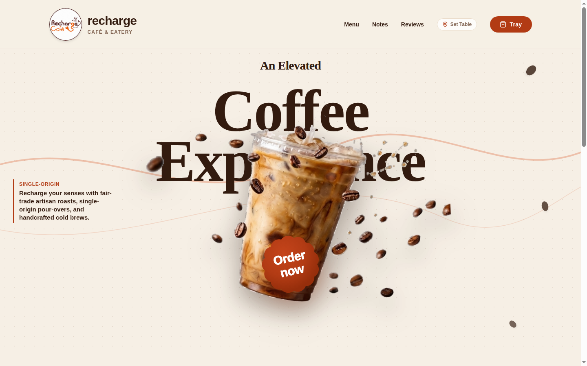
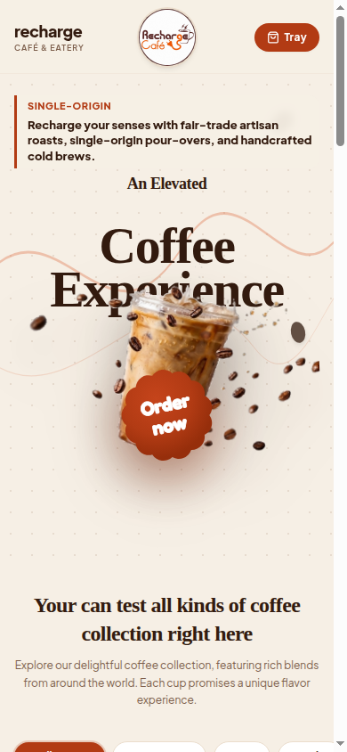
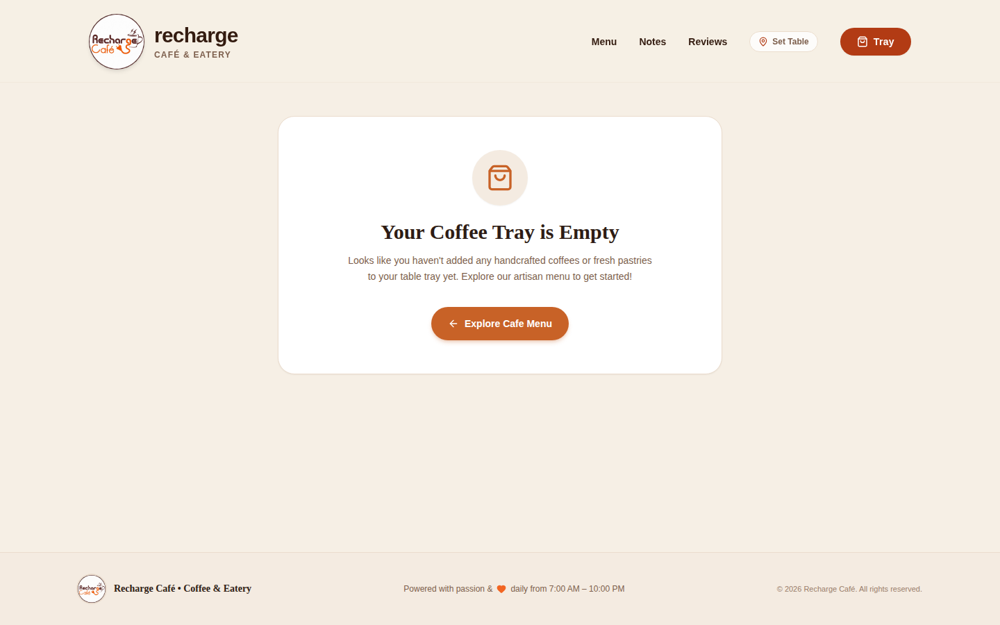
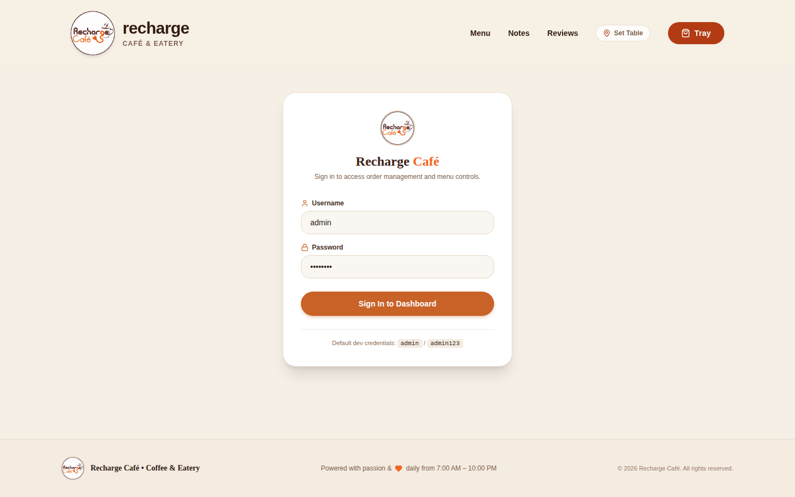
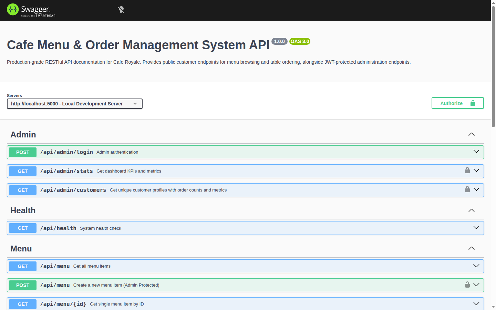

# Recharge Café — Specialty Menu & Order Management System

[](https://mongodb.com)
[](https://cafe-system-hs1i.onrender.com/api/docs)
[](https://docker.com)
[](https://opensource.org/licenses/MIT)

A modern, production-ready Full-Stack MERN ordering application for specialty cafes. Customers can scan a table QR code, browse artisan brews, sort by price, customize their coffee tray, verify their mobile number with OTP, and place orders without requiring an account. Includes a complete real-time Admin Portal for menu management, live order tracking, and customer analytics.

---

## 🌐 Live Deployments & Documentation

| Service | Platform | Live URL |
| :--- | :--- | :--- |
| **Frontend Application** | Vercel | [https://cafe-system-ten.vercel.app](https://cafe-system-ten.vercel.app) |
| **Backend API** | Render | [https://cafe-system-hs1i.onrender.com](https://cafe-system-hs1i.onrender.com) |
| **Interactive API Docs** | Swagger UI | [https://cafe-system-hs1i.onrender.com/api/docs](https://cafe-system-hs1i.onrender.com/api/docs) |
| **API Health Check** | Render/Express | [https://cafe-system-hs1i.onrender.com/api/health](https://cafe-system-hs1i.onrender.com/api/health) |

---

## 📸 Screenshots Showcase

### 1. Artisan Café Experience & Menu Browsing


### 2. Mobile-First Responsive QR Dine-In Ordering


### 3. Real-Time Coffee Tray & Zero-Login Checkout


### 4. Admin Portal: Live Orders & Customer Analytics


### 5. Interactive Swagger OpenAPI 3.0 Documentation (`/api/docs`)


---

## ✨ Core Features

### 1. Customer Experience (Frontend)
- **Zero-Login Table Ordering**: Customers scan a table QR code (e.g. `/?table=T1`) to view the menu and order without tedious account registration.
- **Search, Filter & Sort**:
  - Instant debounced search for brews and dishes.
  - Category pill filter (*Espresso, Cold Brew, Pour Over, Bakery, Refreshers*).
  - Price sorting: **Price: Low to High**, **Price: High to Low**, and Alphabetical.
- **View Mode Switcher**: Seamlessly toggle between **Artisan Card Grid (`⊞`)** and **Compact List View (`☰`)**.
- **Interactive Coffee Tray (Shopping Cart)**:
  - Real-time quantity adjustments (`+` / `-`) and instant item removal.
  - Automatic calculation of subtotal, taxes (5% GST), eco-packaging, and discounts.
  - Persistent storage across sessions.
- **Secure OTP Verification**: Real-world phone verification with Twilio SMS integration and OTP fallback.

### 2. Admin & Business Portal
- **Menu Management (CRUD)**: Create, view, edit price/category/stock, and delete menu items with real-time UI updates.
- **Live Order Workflow**: Update statuses seamlessly (`pending` → `confirmed` → `preparing` → `ready` → `completed` → `cancelled`).
- **Customer Directory**: View customer profiles, phone numbers, total order counts, lifetime spend, and past order history.

### 3. Backend Architecture & Resilience
- **RESTful MVC Architecture**: Built with Node.js and Express.js with clean separation of concerns.
- **Swagger Documentation**: Complete interactive OpenAPI 3.0 documentation accessible directly at `/api/docs`.
- **Database on MongoDB Atlas**: Mongoose schemas with indexed fields and optimized aggregation pipelines.
- **Render Keep-Alive Cron**: Built-in background cron service (`backend/src/utils/cronKeepAlive.js`) that automatically pings `/api/health` every 14 minutes to prevent Render free-tier instances from sleeping.
- **Docker Compose Setup**: Single-command build and run containerization for local execution.

---

## 🛠️ Tech Stack

- **Frontend**: React 18, Vite, Tailwind CSS, Lucide React, Axios, React Router DOM v6
- **Backend**: Node.js, Express.js, Mongoose, Twilio SDK, Helmet, Morgan, Swagger UI & JSDoc, express-validator
- **Database**: MongoDB Atlas
- **DevOps & Containers**: Docker, Docker Compose, Nginx (Alpine), Render, Vercel

---

## 🚀 Quickstart with Docker Compose (Single Command)

Build and start the entire stack (Backend + Frontend + Nginx) with one command:

```bash
docker-compose up --build
```

- **Frontend Application**: [http://localhost:5173](http://localhost:5173) or [http://localhost:3000](http://localhost:3000)
- **Backend API**: [http://localhost:5000](http://localhost:5000)
- **Swagger Docs**: [http://localhost:5000/api/docs](http://localhost:5000/api/docs)

To stop the containers:
```bash
docker-compose down
```

---

## 💻 Manual Local Development Setup

### Prerequisites
- Node.js >= 18.0.0
- npm >= 9.0.0
- MongoDB Atlas account (or local MongoDB)

### 1. Clone the Repository
```bash
git clone https://github.com/Devasshish/cafe-system.git
cd cafe-system
```

### 2. Backend Setup
```bash
cd backend
npm install
cp .env.example .env
```

Configure your `.env`:
```env
PORT=5000
NODE_ENV=development
MONGODB_URI=mongodb+srv://<user>:<password>@cluster.mongodb.net/cafe-system?retryWrites=true&w=majority
CLIENT_URL=http://localhost:5173
JWT_SECRET=your_jwt_secret_here
ADMIN_USERNAME=admin
ADMIN_PASSWORD=your_password
```

Seed initial cafe menu items:
```bash
npm run seed
```

Start the backend server:
```bash
npm run dev
```

### 3. Frontend Setup
In a new terminal:
```bash
cd frontend
npm install
cp .env.example .env
npm run dev
```

Frontend will run at `http://localhost:5173`.

---

## 📖 API Documentation (Swagger)

The full interactive OpenAPI 3.0 documentation is available at:
[https://cafe-system-hs1i.onrender.com/api/docs](https://cafe-system-hs1i.onrender.com/api/docs)

Key endpoints:
| Method | Endpoint | Description |
| :--- | :--- | :--- |
| `GET` | `/api/health` | Health check & uptime monitor (used by Keep-Alive Cron) |
| `GET` | `/api/menu` | List menu items with search, filter, and sort |
| `POST` | `/api/menu` | Create a new menu item *(Admin)* |
| `PUT` | `/api/menu/:id` | Update an existing menu item *(Admin)* |
| `DELETE` | `/api/menu/:id` | Delete a menu item *(Admin)* |
| `POST` | `/api/orders` | Place a customer order |
| `GET` | `/api/orders/:id` | Retrieve order details |
| `GET` | `/api/admin/orders` | List all orders with filters *(Admin)* |
| `PATCH` | `/api/admin/orders/:id/status` | Update order status *(Admin)* |
| `GET` | `/api/admin/customers` | Customer analytics directory *(Admin)* |
| `POST` | `/api/otp/send` | Send SMS verification OTP |
| `POST` | `/api/otp/verify` | Verify OTP code |

---

## ⏰ Render Keep-Alive Cron Job

Render free-tier instances sleep after 15 minutes of inactivity. This repository includes two keep-alive strategies:

1. **Automatic Internal Cron (`backend/src/utils/cronKeepAlive.js`)**:
   Automatically active when deployed to Render (detects `RENDER_EXTERNAL_URL`). Pings the `/api/health` endpoint every 14 minutes.
2. **Standalone Script (`backend/scripts/cron-ping.js`)**:
   Can be triggered from an external cron service (such as cron-job.org or GitHub Actions):
   ```bash
   node scripts/cron-ping.js https://cafe-system-hs1i.onrender.com
   ```

---

## 📄 License
This project is licensed under the MIT License.
